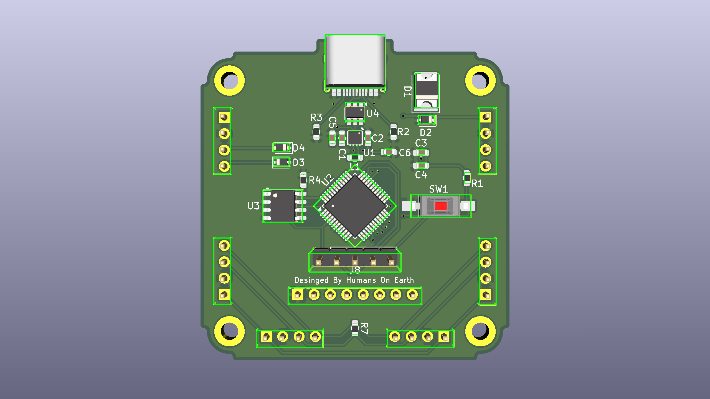
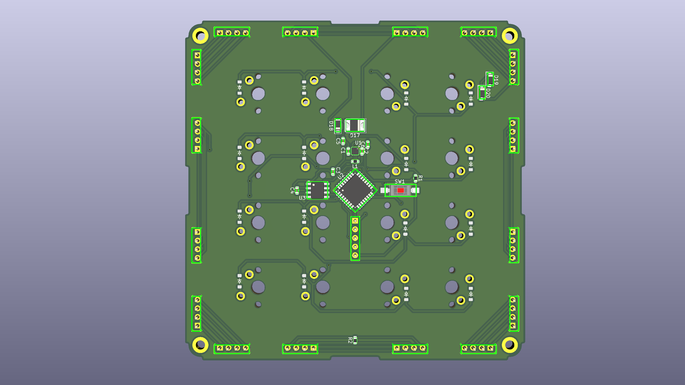

# modu-hardware

KiCad hardware design files, schematics, PCB layouts, and 3D models for the **Modu** modular macro pad system. Modules connect magnetically via 4-pin pogo headers and communicate over a shared CAN bus.

> [!NOTE]
<!-- > Companion desktop control software: **[modu-app](https://github.com/RealWinter/modu-app)** -->

---

## Hardware Modules

| Hub Module (`hub-pcb`) | 4x4 Keypad Module (`4x4-key-pcb`) |
| :---: | :---: |
|  |  |
| Primary USB-C host controller and power/CAN bus bridge. | Snap-on 16-key mechanical switch matrix module. |

### 1. Hub PCB (`hub-pcb`)
The master controller module that interfaces with the host PC over USB-C and distributes power and CAN bus communication to connected satellite modules.
* **MCU:** STM32G0B1CBT6 (`U2`)
* **CAN Transceiver:** SN65HVD230DR (`U3`)
* **Power & Protection:** 3.3V regulation (`U1`), USB-C ESD protection (`U4`), and input reverse/surge protection (`D1`, `D2`)
* **Interconnects:** 6x perimeter 4-pin pogo pin header footprints (left, right, and bottom edges) for multi-directional module docking, plus SWD/debug headers (`J8`)

### 2. 4x4 Keypad PCB (`4x4-key-pcb`)
A 16-key modular keypad expansion board that can dock to the Hub or daisy-chain to other modules from any side.
* **MCU:** STM32G071CBT6 (`U2`)
* **CAN Transceiver:** SN65HVD230DR (`U3`)
* **Switch Matrix:** 4x4 mechanical key switch layout with individual per-key 1N4148W anti-ghosting diodes (`D1`–`D16`)
* **Interconnects:** 16x perimeter 4-pin pogo pin headers (4 per edge across all 4 sides) allowing flexible orientation and chaining

---

## Repository Structure

```text
modu-hardware/
├── hub-pcb/          # KiCad project, schematic, PCB, and STEP model for the Hub module
├── 4x4-key-pcb/      # KiCad project, schematic, PCB, and STEP model for the 4x4 Keypad module
├── hub-pcb.png       # 3D render of the Hub PCB
└── 4x4-key-pcb.png   # 3D render of the 4x4 Keypad PCB